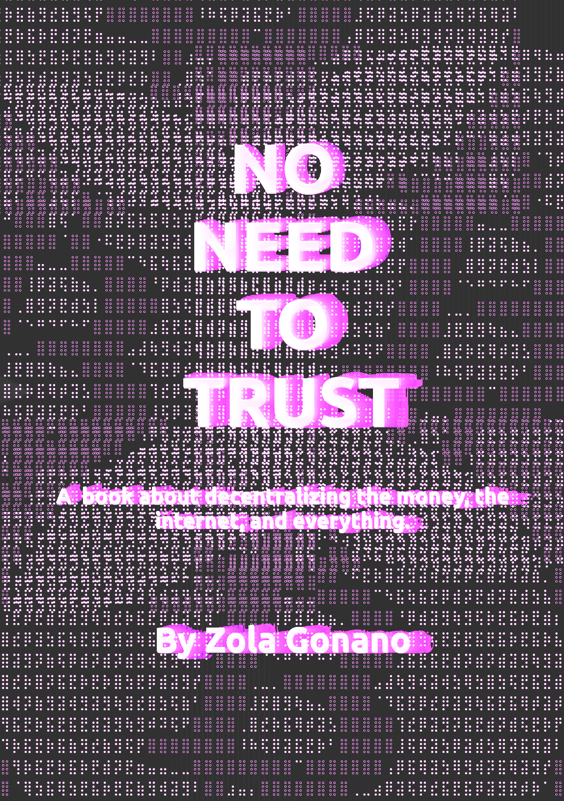

# No Need To Trust

A human-written book about decentralizing the money, the internet, and everything else.

**[Read it online](https://zola.ink/no-need-to-trust/)**

<center></center>

## Why "No Need to Trust"

Because that is exactly what decentralization changed. We no longer have to rely on authorities with our data, money, identity, or votes; we rely on systems backed by cryptographic mathematics, which turned out to be far more reliable than human controlled institutions.

Centralized systems are built on hierarchies of people, and humans are always the most vulnerable part of any structure. Each level of authority introduces more vulnerability than the one below it, and even a perfect leader will not live forever. Power is corrupt. Anarchists have repeated this for many years, and history has consistently supported the claim.

## What's inside

- **Introduction** — who this book is for, what it is not, and why it is called No Need to Trust
- **Chapter 1** — forty years of failed digital money (eCash, b money, bit gold) and the missing pieces Satoshi finally assembled
- **Chapter 2** — cypherpunks and crypto-anarchists: the people who made the ideology before the code existed
- **Chapter 3** — cryptography as a redistribution of power: the Crypto Wars, PGP, and building parallel systems outside authority's control
- **Chapter 4** — the machinery underneath: blockchains, consensus mechanisms, hashes, signatures, and P2P networks
- **Chapter 5** — Ethereum, the EVM, smart contracts, determinism, and scaling
- **Chapter 6** — privacy in decentralized systems, from transparent ledgers to Monero and zero-knowledge proofs (the chapter I personally care about most)
- **Chapter 7** — DAOs and governance without leaders: voting mechanisms, treasuries, and compliance committees
- **Chapter 8** — economics and incentives: tokenomics, mechanism design, and why economic failure breaks code that is technically correct
- **Chapter 9** — staying alive in the jungle: wallets, seed phrases, scams, MEV, and the risks no protocol can fix for you
- **Chapter 10** — beyond money: supply chains, voting, identity, storage, social media, and where decentralization goes next
- **Appendix A** — the technical details I simplified in the chapters, for people who want to open the hood
- **Appendix B** — additional resources
- **Acknowledgements** - acknowledgements about the book

## Building locally

The book is built with [mdBook](https://rust-lang.github.io/mdBook/), first clone the repository then inside it's directory run:

```bash
cargo install mdbook
mdbook serve
```

Then open [http://localhost:3000](http://localhost:3000). `mdbook build` produces the static site in `book/`.


## License

A Ninja's Handbook © 2026 by Zola Gonano is licensed under CC BY-NC 4.0. To view a copy of this license, visit [https://creativecommons.org/licenses/by-nc/4.0/](https://creativecommons.org/licenses/by-nc/4.0/)
